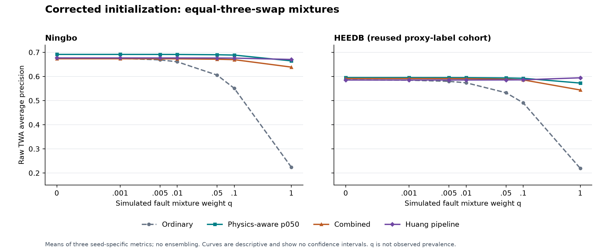

# When limb-cable reversals disrupt ECG classifiers: a matched stress test and comparison of protection strategies

**Working manuscript draft, version 3 — 1 November 2026.** Evidence is limited to the frozen datasets, endpoints, checkpoints, transformations and operating points described below. This version incorporates the completed initialization-corrected calibration-role control. Historical experiment families remain separately identified; their models and numerical values are not interchangeable. This draft does not claim clinical validation or a novel universal architecture.

## Abstract

**Background:** Missing-lead tests and physical terminal reversals alter an ECG in different ways. Robustness measured under one input corruption may not predict performance under another.

**Objective:** To compare ordinary training, five-lead masking, simulated physical reversal training, their combination, chest-only input, and a published detector/correction pipeline under specified reversal conditions, while documenting cross-dataset and calibration tradeoffs.

**Methods:** We distinguish historical masking, architecture and external-pipeline experiments from a corrected calibration-role control on previously examined Ningbo and HEEDB data. In the corrected series, Python, NumPy, Torch and CUDA seeds were set before model construction; three methods (ordinary, physics-aware p050 and combined) were fitted with seeds 104729, 130363 and 155921. Data roles, preprocessing, augmentation recipes and checkpoint-selection rules were retained. Clean source-validation roles were separated for model selection, Platt calibration and thresholds. The complete Huang detector → predicted correction → new ordinary classifier pipeline was also evaluated. Two simulated mixture scenarios, seven q values and 700 paired bootstrap groups were recomputed.

**Results:** At equal-three-swap q=0.1, physics-aware p050 exceeded ordinary TWA AP by 0.1378 (95% paired interval 0.1243–0.1503) on Ningbo and 0.1018 (0.0905–0.1130) on HEEDB. Combined also exceeded ordinary. The Ningbo clean/intermediate-q point leader changed from combined in the original calibration-role series to p050; p050 remained the point leader on HEEDB. At q=0.1, AP intervals for p050-minus-Huang and combined-minus-Huang included zero in both cohorts. Huang led point AP at q=1, although its Ningbo difference from p050 included zero. At q=0.1 both augmentation methods improved calibrated Brier and reduced false positives relative to ordinary; on clean HEEDB, they increased false positives. Historical corrected mask controls, chest-only invariance and the failed Transformer retention gate delimit generalization of these findings.

**Conclusions:** Reversal-aware training retained an advantage over ordinary training in the evaluated simulated scenarios after controlled initialization. Rankings and operating tradeoffs changed across fits, cohorts and fault mixtures; superiority over the Huang pipeline at equal-three q=0.1 was not supported by the corrected paired intervals. This is a sensitivity/reproducibility check on reused data, not independent external validation or evidence of clinical benefit.

## Introduction

Automated ECG systems rely on the lead configuration presented to the classifier. A missing displayed lead and a physical terminal swap are different interventions: missingness removes a signal, whereas a terminal reversal changes a defined set of derived leads while leaving others invariant. Performance under one condition should therefore not be treated as a proxy for the other without direct evaluation.

Prior work already studies ECG lead reversal. Cao, Shi and Wu (ICASSP 2020), “Reversal No Longer Matters: Attention-Based Arrhythmia Detection with Lead-Reversal ECG Data,” DOI [10.1109/ICASSP40776.2020.9053307](https://doi.org/10.1109/ICASSP40776.2020.9053307), precludes broad claims that reversal-robust ECG modeling or simulated reversal evaluation began here. The locally reviewed primary-text access was incomplete; its accessible methods support ordinary training with reversal test sets. We do not attribute reversal augmentation to Cao without a complete primary-text verification. The present work is positioned as a comparison of a particular prespecified reversal family, corrected mask controls, training strategies, chest-only input, selected architectures and a detector/correction chain. The contribution is the bounded comparison and the tradeoffs it reveals.

The historical experiments ask: (1) how does ordinary training perform under a physically specified RA–LL swap compared with reversal-aware training? (2) how do missing-lead controls, chest-only input, and alternative architectures change interpretation? (3) how do four training mixtures compare over mostly-clean and high-fault evaluation mixtures? (4) what does source-validation calibration change about probability error and operating decisions? The latest sensitivity question is whether the calibration-role comparisons persist when initialization is controlled and matched across methods for each seed.

## Methods

### Datasets and endpoints

The source test datasets are Chapman (2,050 ECGs) and Ningbo (6,981 ECGs). Each model predicts TWA (primary), SB and STach (secondary), using fixed SNOMED-coded labels in the source protocols: TWA `164934002`, SB `426177001`, and STach `427084000`. For external HEEDB I0006 (Emory), physician-code mappings are proxies and are not asserted to be equivalent to the SNOMED labels. The initial corrected external analysis and the later patient-disjoint confirmation used two different 10,000-patient cohorts from Emory, each with one ECG per patient. The six-method extension reused the latter confirmation cohort after prior access to its outcomes; it did not evaluate a third cohort or a new external center. The mappings have not been clinically adjudicated; this limits interpretation rather than constituting an additional experiment in this package. Ningbo membership separation is established at record/waveform level; patient independence is not established.

### Physical transformation and missing-lead controls

The canonical lead order is I, II, III, aVR, aVL, aVF, V1–V6. Exact RA–LL physical terminal exchange changes derived leads I, II, III, aVR and aVF; aVL and V1–V6 remain invariant. The exact five-lead mask removes indices `[0,1,2,3,5]`, namely I, II, III, aVR and aVF, replacing them with the frozen training-mean sentinel before normalization while leaving the remaining seven channels unchanged. The mask shares the affected lead names with the swap but does not reproduce its waveform transformation. The complete mask panel contains all 792 combinations of five displayed leads; metrics are computed separately by mask and then summarized, without averaging prediction vectors.

An audit found that earlier Ningbo mask code retained the selected five leads and replaced the other seven, the opposite of the intended operation. Historical packages and their bound sources were retained. A corrected evaluator was used for the versioned recovery analysis; the previous exact-mask Ningbo AUPRC near 0.527 and conclusions based on the inverted panel are superseded.

### Models and training comparisons

The ResNet four-arm Ningbo follow-up used three seeds. The four arms were: clean, 100% clean training examples; masking, 50% clean and 50% five-lead masks; physics-aware, 50% clean and 50% physical reversals; and combined, 50% clean, 25% masks and 25% physical reversals. Masking and combined were newly fitted; clean and physics-aware checkpoints were reused after binding/integrity checks. This is a follow-up after prior test access, not untouched confirmation. Combined receives half the physical-reversal exposure of physics-aware, so their comparison cannot isolate the causal effect of adding masking or select an optimal augmentation probability `p_aug`.

Chest-only ResNets use V1–V6 with train-derived per-channel normalization and do not receive limb leads, masking or reversal augmentation. TimePatchTransformer M3 compared clean and physics-aware training on Chapman under a frozen retention gate. ECGFounder was evaluated only as a frozen pretrained backbone with a trained head; it was not tested for mitigation.

### Corrected initialization and role-separated calibration

The original calibration-role runner constructed ECGResNetSmall before setting its fit seed. Its saved checkpoints remain evaluable, but initial states cannot be recovered from those seeds. A separate corrected series set Python, NumPy, Torch CPU and CUDA seeds before construction and recorded initial tensors, named-tensor hashes and RNG states. Initialization checks used 18 fresh processes; the same seed produced the same initial state across methods and processes, while different seeds differed. Deterministic execution settings and explicit training/inference DataLoader generators were recorded. A two-epoch engineering check compared continuous and interrupted/resumed execution. It was not a second independent execution of all nine full trajectories.

Nine fits crossed ordinary, physics-aware p050 and combined training with seeds 104729, 130363 and 155921. Ordinary used clean inputs; p050 used 50% clean/50% uniformly selected physical reversals; combined used 50% clean/25% uniformly selected five-displayed-lead masks/25% reversals. Existing train-only preprocessing, data order, architecture, loss, optimizer, batch sizes and AMP were retained. The correction also isolated loader RNG streams and strengthened determinism; old/new differences do not isolate an initialization-only causal effect.

The unchanged Ningbo roles comprised 24,430 train, 1,744 model-selection, 872 calibration-A, 872 threshold-B and 6,981 test records. Checkpoints were chosen by model-selection TWA AP, with at most 30 epochs, patience five, strict improvement and the earliest epoch on a tie. All nine models passed the predeclared adequacy/replay gates and were locked before A/B scoring. Positive-slope Platt fits used clean A scores only; raw thresholds were the linearly interpolated 90th percentile of negative clean B scores, with a positive decision at score ≥ threshold. No test or HEEDB scores/labels entered these fits. Thirty-six method/seed/endpoint calibration and threshold entries cover the three trained methods plus Huang's complete pipeline.

The Huang detector and validated detector-probability caches were retained; diagnostic predictions used the new ordinary classifiers and the full frozen 500-Hz correction/diagnostic path. Old classifier predictions, calibrators and thresholds were not substituted for the new series. The HEEDB analysis reused the previously examined 10,000-patient cohort and its coded proxy labels.

Both RA–LL-only and equal-three-swap mixtures use condition order clean, RA–LA, RA–LL, LA–LL. Their respective weights are [1−q, 0, q, 0] and [1−q, q/3, q/3, q/3], at q = 0, 0.001, 0.005, 0.01, 0.05, 0.1, 1. Scores and labels are pooled with these weights; prediction vectors are not averaged into an ensemble. q is a constructed evaluation weight, not observed fault prevalence or the training augmentation probability.

Seven hundred paired contrast groups span two cohorts, two scenarios, seven q values, five method contrasts and five metrics (raw AP, raw/calibrated Brier, raw sensitivity and false positives per 1,000 evaluated ECGs). Each group uses 1,000 frozen synchronized resamples: records for Ningbo and patients for HEEDB. Each draw averages seed-specific left-minus-right metric differences. Percentile 2.5/97.5 intervals are unadjusted and conditional on the fitted models, calibrators and thresholds; they do not capture all training or calibration-fitting uncertainty. Point estimates use the full cohort and are distinguished from bootstrap means.

### Historical calibration and six-method context

The older six-pipeline extension used 1,744 records in each calibration-A and threshold-B subset after checkpoint selection had used the full validation set. That selection dependence is a limitation of those historical fits. The later role-separated series and its corrected initialization repeat use smaller A/B roles as specified above. Comparisons with the six-pipeline extension are descriptive across different fits/roles and cannot isolate the effect of role separation. Masking-only and chest-only models were not retrained in the corrected nine-fit series. Historical six-method numbers remain in the supplement as context, not the current corrected-series leaderboard.

### Analysis and implementation runtime

Primary evaluation uses TWA AUPRC. AUROC, Brier, ECE-15 and validation-threshold operating metrics provide complementary descriptions; SB and STach are secondary. Paired comparisons use the frozen patient/record bootstrap artifacts; the corrected-series source package completed new inference and bootstrap calculations before this manuscript update. This synthesis exports existing aggregate tables only and performs no further training, inference, calibration or bootstrap generation. Runtime values are from the frozen integrated deployment v4 implementation, measured by direct end-to-end CPU request/response on a balanced 128-record Ningbo fixture, one framework thread and fixed CPU affinity over seven runs.

## Results

### Historical corrected reversal and mask results

For Ningbo TWA, ordinary ResNet seed-mean AUPRC was 0.6761 on clean ECG and 0.1822 under RA–LL; physics-aware ResNet was 0.6869 and 0.6665, respectively. The full-sample seed-mean RA–LL difference is +0.4843; the report's paired-bootstrap mean difference is +0.4836 (95% interval +0.4564 to +0.5090). The corrected full-sample mean-mask-minus-RA–LL contrast reduction was +0.4657 (95% paired interval +0.4400 to +0.4891). Chapman RA–LL TWA AUPRC increased from 0.3278 to 0.6372 (+0.3094) for the corresponding ordinary-to-physics-aware comparison. These are corrected analyses of specified simulations, not observations of real acquisition failures. See `../mask_semantics_recovery_v2/FINAL_RECOVERY_REPORT.md` and `PRIMARY_CONTRASTS.csv`.

On Ningbo, masking minus clean-trained TWA AUPRC was −0.0130 under RA–LL (95% CI −0.0192 to −0.0060) and +0.0598 across the 792-mask mean (+0.0502 to +0.0696). Combined minus physics-aware was −0.0101 on clean (−0.0196 to −0.0009), −0.0218 under RA–LL (−0.0325 to −0.0122) and +0.0371 across the mask mean (+0.0288 to +0.0446). This profile must be read with the unequal reversal exposure and the three-seed limitation. See `../ningbo_four_arm_replication_v1/FINAL_FOUR_ARM_REPORT.md`.

The corrected Ningbo mask controls retain the distinction between masking the same affected lead names and averaging across all five-lead removals:

| Training arm | Clean TWA AUPRC | RA–LL | Mean of 792 masks | Exact affected-lead mask |
|---|---:|---:|---:|---:|
| Ordinary | 0.6761 | 0.1822 | 0.5863 | 0.4358 |
| Physics-aware | 0.6869 | 0.6665 | 0.6049 | 0.6260 |

Values are full-cohort means of three seed-specific metrics from `../mask_semantics_recovery_v2/PRIMARY_CONTRASTS.csv`. In the ordinary arm, the mean-mask-minus-RA–LL difference is +0.4042 (95% CI +0.3809 to +0.4257), and the exact-mask-minus-RA–LL difference is +0.2536 (+0.2316 to +0.2778). The 792-mask average summarizes a specified panel; it does not imply that every individual mask is less damaging than RA–LL.

### Historical chest-only control and architecture results

Chest-only TWA predictions were exactly invariant between clean and simulated RA–LL input in the checked inference path. Physics-aware minus chest-only RA–LL AUPRC was −0.0131 (95% CI −0.0282 to +0.0008) in Chapman and +0.0111 (−0.0014 to +0.0231) in Ningbo. On clean ECG, the differences were +0.0137 (−0.0017 to +0.0299) and +0.0315 (+0.0178 to +0.0438), respectively. These intervals do not establish equivalence and do not show universal physics-aware superiority. See `../chest_only_baseline_v1/PAIRED_CONTRASTS.csv`.

TimePatchTransformer showed an RA–LL TWA improvement, but M3A failed its frozen architecture-specific criterion: for seed 155921, physics-aware mean-mask AUPRC declined by 0.1126, exceeding the maximum permitted 0.04 decline. Other listed M3A conditions, including all three RA–LL gains, passed. This is a mask-retention failure rather than absence of the measured RA–LL effect. No Stage B or Ningbo Transformer analysis followed. ECGFounder results concern a frozen backbone with trained heads only; no Founder mitigation was tested. See `../architecture_replication_m3_recovery_v2/FINAL_M3_DECISION.md` and `../ecgfounder_baseline_v2/`.

### Historical external six-method comparison and calibration

The historical corrected TWA HEEDB table is in `../submission_evidence_v2/EXTERNAL_SIX_METHOD_CORRECTED_SUMMARY.md` and has one row per method/q. At q=0, raw AUPRC was 0.592 for combined, 0.576 physics-aware, 0.572 Huang, 0.568 masking, 0.573 ordinary and 0.537 chest-only. At q=0.1, the corresponding values were 0.587, 0.575, 0.573, 0.418, 0.421 and 0.537. At q=1, values were 0.554, 0.568, 0.581, 0.159, 0.165 and 0.537. Combined exceeded Huang at low q but not q=1; the interval for combined-minus-Huang at q=1 excludes zero in the unfavorable direction. Combined's clean q=0 direction versus physics-aware was positive on HEEDB but negative on Ningbo; only its high-fault disadvantage has the same direction. Do not describe these scenario rankings as a universal winner.

At q=0.01, calibrated TWA sensitivity/specificity were 0.661/0.910 for combined and 0.617/0.919 for Huang; predicted-positive fractions are in the corrected table and paired sensitivity/specificity intervals are in `../heedb_four_arm_extension_v1/PAIRED_CONTRASTS_BOOTSTRAP.csv`. Source-validation calibration improved measured probability-error metrics relative to raw scores, while a matching monotone transformation of scores and thresholds preserved decisions in the audit. All 108 audit rows had zero operating-decision mismatches; clipping can introduce ties. Thus improved Brier does not itself imply that more cases are called positive. At q=1, masking raw Brier was 0.567 versus calibrated Brier 0.304; its AUPRC was 0.159 and sensitivity 0.693. Calibration did not recover its lost ranking. Improved source-calibrated error on these external proxy labels does not establish valid clinical probability calibration for the intended ECG construct.

### Corrected initialization series: current role-control results

All nine requested fits passed their gates. Table 1 summarizes the corrected series; its rows must not be mixed with the historical six-method values above.

**Table 1. Raw TWA AP, mean ± SD over three seeds; equal-three-swap scenario.**

| Cohort | Pipeline | q=0 | q=0.1 | q=1 |
|---|---|---:|---:|---:|
| Ningbo_test | Ordinary | 0.6766 ± 0.0036 | 0.5505 ± 0.0245 | 0.2239 ± 0.0165 |
| Ningbo_test | Physics-aware p050 | 0.6911 ± 0.0015 | 0.6883 ± 0.0009 | 0.6642 ± 0.0036 |
| Ningbo_test | Combined | 0.6731 ± 0.0074 | 0.6693 ± 0.0078 | 0.6384 ± 0.0140 |
| Ningbo_test | Huang pipeline | 0.6763 ± 0.0035 | 0.6757 ± 0.0036 | 0.6701 ± 0.0040 |
| HEEDB | Ordinary | 0.5855 ± 0.0114 | 0.4904 ± 0.0194 | 0.2190 ± 0.0104 |
| HEEDB | Physics-aware p050 | 0.5951 ± 0.0166 | 0.5922 ± 0.0156 | 0.5723 ± 0.0100 |
| HEEDB | Combined | 0.5912 ± 0.0084 | 0.5855 ± 0.0092 | 0.5436 ± 0.0304 |
| HEEDB | Huang pipeline | 0.5849 ± 0.0128 | 0.5857 ± 0.0131 | 0.5941 ± 0.0160 |

**Figure 1.** Corrected-series AP means over three seed-specific metrics; curves show no confidence intervals. The q axis is linear near zero and logarithmic above 0.001. q is a simulated mixture weight, not observed prevalence. The [vector figure](SEED_CORRECTED_AP.svg) is available for typesetting.

**Table 2. Corrected-series differences from ordinary at equal-three q=0.1.**

Entries are full-cohort mean-seed differences [unadjusted 95% paired percentile interval]. Higher AP/sensitivity is favorable; lower Brier/false positives is favorable. False positives are per 1,000 evaluated ECGs, not per 1,000 negatives.

| Cohort | Pipeline | AP raw | Brier calibrated | Sensitivity raw | FP per 1,000 raw |
|---|---|---:|---:|---:|---:|
| Ningbo_test | Physics-aware p050 | +0.1378 [+0.1243, +0.1503] | -0.0141 [-0.0152, -0.0129] | +0.0276 [+0.0133, +0.0413] | -29.1 [-31.9, -26.3] |
| Ningbo_test | Combined | +0.1187 [+0.1066, +0.1313] | -0.0122 [-0.0132, -0.0111] | +0.0064 [-0.0061, +0.0194] | -29.9 [-32.5, -27.0] |
| HEEDB | Physics-aware p050 | +0.1018 [+0.0905, +0.1130] | -0.0106 [-0.0118, -0.0094] | +0.0407 [+0.0292, +0.0521] | -12.2 [-14.7, -9.7] |
| HEEDB | Combined | +0.0951 [+0.0839, +0.1058] | -0.0108 [-0.0120, -0.0098] | +0.0341 [+0.0229, +0.0454] | -14.7 [-17.0, -12.4] |

At clean/intermediate q, p050 is the corrected-series AP point leader in both cohorts. Relative to the original role-control series, the Ningbo leader changed from combined to p050; HEEDB retained p050. These are point rankings. In particular, at equal-three q=0.1, p050-minus-Huang AP was +0.0126 [−0.0002, +0.0248] on Ningbo and +0.0065 [−0.0056, +0.0174] on HEEDB. Combined-minus-Huang was −0.0064 [−0.0176, +0.0043] and −0.0002 [−0.0123, +0.0105], respectively. None of these intervals excludes zero. The original role-control's positive intermediate-q comparisons against Huang are therefore not sustained as interval-supported advantages in the corrected series.

At equal-three q=1, Huang retained the point AP lead. P050-minus-Huang was −0.0060 [−0.0227, +0.0088] on Ningbo and −0.0218 [−0.0362, −0.0100] on HEEDB. Huang's AP advantage over combined was supported in both cohorts. These intervals do not establish equivalence when they include zero.

Operating effects depend on the scenario: at q=0.1, p050 improved sensitivity and reduced false positives against ordinary in both cohorts; combined's Ningbo sensitivity interval included zero despite its AP/Brier improvement. On clean HEEDB, p050 and combined added about 10.9 and 7.6 false positives per 1,000 evaluated ECGs relative to ordinary, with positive paired intervals. Better ranking or calibrated Brier does not remove this clean-data tradeoff. Raw/calibrated decisions use correspondingly transformed thresholds and remain the same in the reported metric tables.

The complete [corrected-series tables](SEED_CORRECTED_RESULTS.md) contain both scenarios and all seven q values. [All 700 paired contrasts](SEED_CORRECTED_TWA_CONTRASTS.csv) retain full precision. These results apply to the specified corrected fits on reused data; they do not retroactively reproduce the unknown original initialization states.

### Historical held-out cycles and identity-path sensitivity

Separate post-access analyses evaluated two limb-terminal cycle compositions not used as training augmentations on existing Chapman/Ningbo models. Physics-aware and combined outperformed ordinary on both compositions in both cohorts; chest-only predictions were invariant. These were historical-model analyses, not evaluations of the nine corrected role-control fits. Identity re-derivation of clean limb leads produced small measured probability/metric shifts; it did not materially change the reported cycle contrasts. These checks extend the tested simulation conditions without establishing robustness to real acquisition faults. See [the cycle report](../heldout_limb_cycles_v1/FINAL_HELDOUT_CYCLES_REPORT_RU.md) and [identity sensitivity report](../identity_rederivation_sensitivity_v1/FINAL_REPORT_RU.md).

### Historical runtime

On the frozen CPU fixture, the physics-aware worker's warm batch-one median/p95 request-to-response time was 10.59/12.42 ms versus 31.51/34.16 ms for the complete Huang detection, predicted correction and clean ResNet chain (2.97× median ratio). Maximum sampled process-tree working set was 612.2 versus 953.6 MiB; time to ready was 5.82 versus 10.98 seconds. Output agreement was checked before timing. These values apply only to these implementations, the documented AMD Ryzen AI 7 350 laptop, single-thread/affinity configuration, and workload; they are not Huang-paper latencies or clinical workflow evidence. See `../integrated_deployment_v4/FINAL_DECISION.md`.

## Discussion

The corrected analyses support a narrow observation: for the evaluated ResNet configurations, physical reversal-aware training markedly improved TWA ranking under simulated RA–LL relative to ordinary clean training. That does not imply one mitigation dominates all alternatives. Chest-only is invariant by construction, while the paired primary-endpoint intervals do not establish a consistent augmented-model advantage over it. Masking improves panel-average performance in the Ningbo four-arm analysis but does not protect against RA–LL. Combined training exchanges performance across clean, reversal and mask conditions, and its reversal exposure differs from the physics-aware arm. External mostly-clean scenarios show why both the fault mixture weight and operating point matter.

This work does not assert that missing-lead testing is generally inadequate: it shows that a specific physical transformation and specified masking transformations yield different measurements in these experiments. The exact mask is an informative channel-matched control, not an equivalent corruption. The audit itself is a material part of the evidence: earlier results that used the inverse mask should not be silently carried forward.

The corrected initialization repeat preserves augmentation-versus-ordinary ranking gains while changing the Ningbo leader and weakening intermediate-q comparisons against Huang. Thus a point winner in an earlier fit series should not become a universal method claim. The initial states of the original role-control fits are unknown, and explicit loader RNG isolation/determinism also changed; old/new differences are a sensitivity comparison, not an isolated causal estimate of the seed-order error.

The external comparison uses proxy labels and historical model access. A post-hoc Huang pipeline with a validation-selected threshold is a comparator, not a reproduction of the original published study or proof of equivalence. The two HEEDB samples share Emory. Calibration was fit on source validation, not on HEEDB test outcomes. Bootstrap intervals are conditional on chosen checkpoints/calibrators, and three seeds incompletely quantify training variation. Crossing zero is not evidence of equivalence.

## Limitations and manuscript status

All faults are simulated. Two held-out compositions were tested in a separate historical-model analysis, but real registered miswirings were not evaluated. Coded ECG interpretation targets and HEEDB proxy mappings have not been clinically adjudicated. Ningbo separation is record/waveform-based; patient independence is not established. HEEDB was reused after prior access and is not a new independent external validation or a second center. No reserved cohort was opened for this correction. No disease-diagnosis accuracy, clinical benefit, workflow improvement or prospective safety is established.

Initialization matching was tested across methods and fresh processes. All nine complete training trajectories were not independently repeated a second time. Confidence intervals condition on selected models/calibrators/thresholds, use only three fitted seeds and are not multiplicity-adjusted. A positive point contrast with an interval including zero does not establish superiority or equivalence. Original fit initialization states are unavailable, and the correction includes RNG-stream/determinism changes, preventing a pure causal attribution to initialization order.

Historical mask/architecture, six-method, cycle and runtime results have different model/role bindings from the current nine-fit series. M3 failed its full retention criterion and did not proceed to Ningbo. ECGFounder mitigation was not evaluated. Literature coverage is bounded; the complete Cao primary text was not locally verified, and no priority or superiority claim against that work is made. Runtime applies only to the documented historical CPU implementation and workload, not the corrected checkpoints or clinical equipment.

This is a draft for author review with updated evidence and a reproducible aggregate-table export. Author, affiliation, reference-format and venue requirements remain editorial submission work. No clinician contact, new cohort acquisition, new training, or additional experiment is scheduled by this package.

## Artifact references

The current [source index](SOURCE_OF_TRUTH.md) separates corrected-series and historical evidence. [Tables and full-precision CSVs](SEED_CORRECTED_RESULTS.md), the [claim ledger](CLAIMS_AND_EVIDENCE.md), and [version changes](CHANGES_FROM_V2.md) govern numerical interpretation. Historical version 2 is retained unchanged at [its manuscript](../submission_evidence_v2/MANUSCRIPT_DRAFT.md). Scientific protocols and their original hashes remain unchanged; documentation provenance updates are recorded separately.
